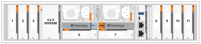

= Informationen zum Hinzufügen und Ersetzen von E/A-Modulen in einem AFX 1K System
:allow-uri-read: 
:icons: font
:imagesdir: ../media/

[role="lead"]
Das AFX 1K Storage-System bietet Flexibilität beim Erweitern oder Austauschen von E/A-Modulen, um Netzwerkkonnektivität und Performance zu verbessern. Das Hinzufügen eines E/A-Moduls ist unerlässlich, wenn die Netzwerkfunktionen erweitert werden sollen. Der Austausch eines E/A-Moduls ist unerlässlich, um ein ausgefallenes Modul zu ersetzen.

Sie können ein ausgefallenes E/A-Modul in Ihrem AFX 1K-Speichersystem durch den gleichen E/A-Modultyp oder durch einen anderen E/A-Modultyp ersetzen.  Sie können einem System mit leeren Steckplätzen auch ein E/A-Modul hinzufügen.

* link:io-module-add.html["Fügen Sie ein I/O-Modul hinzu"]
+
Durch das Hinzufügen zusätzlicher Module kann die Redundanz verbessert werden, wodurch sichergestellt wird, dass das System auch bei einem Ausfall eines Moduls betriebsbereit bleibt.

* link:io-module-replace.html["Ersetzen Sie ein E/A-Modul"]
+
Durch das Ersetzen eines fehlerhaften E/A-Moduls kann das System in den optimalen Betriebszustand zurückversetzt werden.

.Nummerierung des E/A-Steckplatzes
Die E/A-Steckplätze des AFX 1K-Controllers sind von 1 bis 11 nummeriert, wie in der folgenden Abbildung gezeigt.

